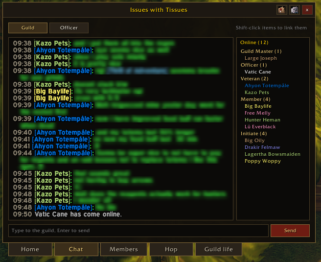
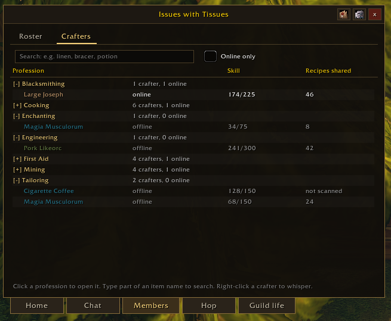
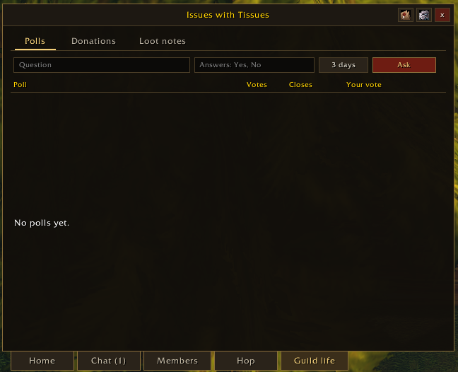
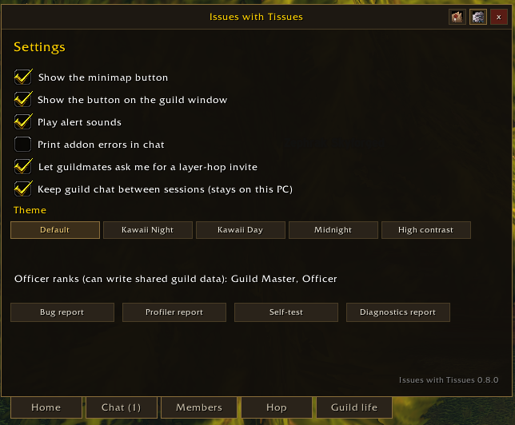

# Issues with Tissues

A guild addon for the Issues with Tissues guild on WoW: Forever. It puts guild chat, the roster, crafters, polls and donations in one window, and shares everything between guildmates who run it.

## Install

1. Download `IssuesWithTissues-vX.Y.Z.zip` from the [latest release](https://github.com/carraigo/issues-with-tissues/releases/latest) (not the "Source code" zips).
2. Unzip it into your game's `Interface\AddOns` folder, so you have `Interface\AddOns\IssuesWithTissues`.
3. Restart the game.

Open it with `/iwt`, the minimap button, the **Tissues** button on the guild window, the game's Options (AddOns, Issues with Tissues), or a key: Key Bindings, Issues with Tissues (bind it to J to replace the game's guild window). The addon tells you once when a guildmate has a newer version.

## Features

- **Home**: the guild at a glance (members online, players with alts counted once, how many use the addon, guild kill totals and the Elite Soldier with the most honourable kills), your character and its main, your professions, and a "What's on" box with open polls, the donation goal and this week's guild news (joins, leavers, level 60s and promotions). Officers get a nudge in chat when someone joins.
- **Chat**: guild and officer chat in the window, with item links, class colours, a Newest button when you've scrolled up, an unread count on the tab and the minimap button, and a list of who's online by rank. Earlier chat loads from the game's own guild chat history, and the addon keeps a copy of the last 300 lines on your PC (never shared with anyone).
- **Members**: the whole guild with level, class, honourable kills, rank and when they were last on, a name search, filters (online, away 7, 14 or 30 days) and alts grouped under their main. Hover for their guild note (officers also see the officer note). Right-click someone to whisper or invite them. Officers can also promote and demote from here.
- **Crafting**: a green "Guild craftable" line on item tooltips when someone in the guild can make the item. Search who can make an item, or browse by profession. Only crafting professions are tracked (Alchemy, Blacksmithing, Enchanting, Engineering, Leatherworking, Tailoring and Cooking).
- **Guild life**
  - **Polls**: officers ask, everyone votes once.
  - **Donations**: a guild goal with progress. Gold put into the guild bank is noted automatically. Only the officer who set a goal can change it, or allow another officer to. The Guild Master can always change it.
  - **Loot notes**: a shared record of who received which item.
- **Settings** (the cog): themes (Default, Kawaii Night, Kawaii Day, Midnight, High contrast), window size, which tab the window opens on, the minimap and guild window buttons, alert and window sounds, hiding the window in combat, saving chat between sessions, 12 or 24-hour chat times, the "Guild craftable" tooltip line, and the bug report, profiler, self-test and diagnostics report.

Ctrl+F jumps to the search on Roster, Crafters and Loot notes, and Enter picks the first result.

Officers (Guild Master and Officer ranks) can add polls, donation goals and loot notes. Everyone else can read them and take part.

The addon only talks to guildmates, over hidden guild addon messages.

## Commands

| Command | What it does |
| --- | --- |
| `/iwt` | open or close the window |
| `/iwt settings` | open the settings |
| `/iwt scale 90` | window size in percent (70 to 130) |
| `/iwt chat` | open guild chat |
| `/iwt roster` | open the roster |
| `/iwt inactive 7\|14\|30` | members away that many days or more |
| `/iwt alt main` · `/iwt alt add Name` · `/iwt alt remove Name` · `/iwt alt` | set this character as your main, link an alt, unlink it, or list your links |
| `/iwt craft <name>` | who in the guild can make an item |
| `/iwt bug` | copyable bug report, with memory use |
| `/iwt selftest` | check the addon works on your client |
| `/iwt perf on\|off\|reset` · `/iwt perf` | turn the profiler on or off, reset it, or show its report |
| `/iwt report` | diagnostics report to send (paste it at [iwt-stats](https://carraigo.github.io/iwt-stats/#report)) |
| `/iwt new` | what's new in this version |
| `/iwt update` | the download link for the newest version |
| `/iwt welcome` | show the welcome card again |
| `/iwt version` | the addon version |

## How it works

There's no server: every guildmate's addon keeps a copy of the shared data, and the copies sync over hidden guild addon messages. [docs/ARCHITECTURE.md](docs/ARCHITECTURE.md) explains the messaging, the sync rules, the chat history, themes, diagnostics and the tests.

## Changes

See [CHANGELOG.md](CHANGELOG.md) for what's new in each version.

## Screenshots

| Home | Crafters |
| --- | --- |
|  |  |
| **Polls** | **Settings and themes** |
|  |  |

## Licence

© 2026 Issues with Tissues. All rights reserved. You may install and use the addon; please ask before reusing the code.
