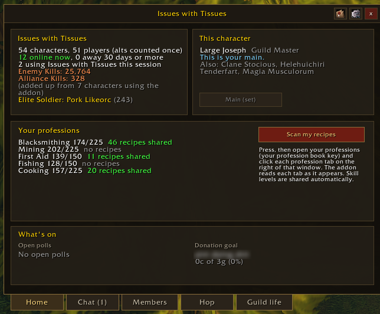

# Issues with Tissues

A guild addon for the Issues with Tissues guild on WoW: Forever. It puts guild chat, the roster, crafters, layer hopping, polls and donations in one window, and shares everything between guildmates who run it.

## Install

1. Download `IssuesWithTissues-vX.Y.Z.zip` from the [latest release](https://github.com/carraigo/issues-with-tissues/releases/latest) (not the "Source code" zips).
2. Unzip it into your game's `Interface\AddOns` folder, so you have `Interface\AddOns\IssuesWithTissues`.
3. Restart the game.

Open it with `/iwt`, the minimap button, the **Tissues** button on the guild window, or a key: Key Bindings, Issues with Tissues (bind it to J to replace the game's guild window).

## Screenshots

| Home | Crafters |
| --- | --- |
|  |  |
| **Polls** | **Settings and themes** |
|  |  |

## Features

- **Home**: the guild at a glance (members online, players with alts counted once, guild kill totals and the Elite Soldier with the most honourable kills), your character and its main, your professions, and a "What's on" box with open polls and the donation goal.
- **Chat**: guild and officer chat in the window, with item links and class colours, and a list of who's online by rank. History stays on your PC.
- **Members**
  - **Roster**: the whole guild with level, class, honourable kills and professions, filters (online, away 7, 14 or 30 days) and alts grouped under their main.
  - **Crafters**: search who can make an item, or browse by profession.
- **Hop**: see which layer you and guildmates are on, and ask a guildmate for a layer-hop invite.
- **Guild life**
  - **Polls**: officers ask, everyone votes once.
  - **Donations**: a guild goal with progress. Gold put into the guild bank is noted automatically. Only the officer who set a goal can change it, or allow another officer to.
  - **Loot notes**: a shared record of who received which item.
- **Settings** (the cog): themes (Default, Kawaii Night, Kawaii Day, Midnight, High contrast), alerts, sounds, minimap button, bug report, profiler, self-test and diagnostics report.

Officers (Guild Master and Officer ranks) can add polls, donation goals and loot notes. Everyone else can read them and take part.

The addon only talks to guildmates, over hidden guild addon messages.

## Commands

| Command | What it does |
| --- | --- |
| `/iwt` | open or close the window |
| `/iwt settings` | open the settings |
| `/iwt chat` | open guild chat |
| `/iwt roster` | open the roster |
| `/iwt inactive 7\|14\|30` | members away that many days or more |
| `/iwt alt add Name` · `/iwt alt remove Name` · `/iwt alt` | link an alt, unlink it, or list your links |
| `/iwt craft <name>` | who in the guild can make an item |
| `/iwt layer` | your layer and guildmates' layers |
| `/iwt hop Name` | ask a guildmate for a layer-hop invite |
| `/iwt bug` | copyable bug report |
| `/iwt selftest` | check the addon works on your client |
| `/iwt report` | diagnostics report to send (paste it at [iwt-stats](https://carraigo.github.io/iwt-stats/#report)) |
| `/iwt version` | the addon version |

## How it works

There's no server: every guildmate's addon keeps a copy of the shared data, and the copies sync over hidden guild addon messages. [docs/ARCHITECTURE.md](docs/ARCHITECTURE.md) explains the messaging, the sync rules, the chat history, themes, diagnostics and the tests.

## Changes

See [CHANGELOG.md](CHANGELOG.md) for what's new in each version.

## Licence

© 2026 Issues with Tissues. All rights reserved. You may install and use the addon; please ask before reusing the code.
