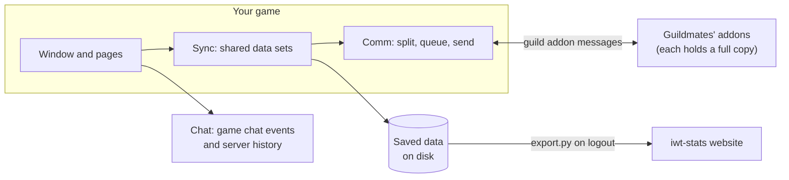

# How Issues with Tissues works

A tour of the addon for anyone reading the code. For what it does, see the [README](../README.md).

There's no server. Every guildmate running the addon keeps a full copy of the guild's shared data, and the copies keep each other up to date over WoW's hidden guild addon messages.

## Messages (`Comm.lua`)

- Everything goes over the `IWT` prefix, to the guild or as a whisper to one guildmate.
- The game caps a message at 255 bytes, so longer ones are split into numbered pieces and put back together on arrival. Outgoing pieces are queued and sent a few per second, so the game never drops them.
- Each handler states who may send it: any guild member, officers only, or anyone. Officer checks use the receiver's own copy of the roster, never what the sender claims.
- On Forever, characters have a first name and a surname, and two guildmates can share a first name. When the game only stamps the first name, the sender's claimed full name is accepted only if the first names match.

## Shared data (`Sync.lua`)

Every feature that shares data defines a *set*. Each set has a rule for who may write to it:

| Set | Who writes | Used by |
| --- | --- | --- |
| `polls`, `dgoal`, `loot` | officers | polls, donation goal, loot notes |
| `profs`, `kills`, `alts`, `votes`, `donated` | the owner (the key is their own name) | professions, honourable kills, alt links, votes, donations |
| `recipes` | any member, but only for their own characters | crafters |

- A record holds its data, who wrote it, and a revision (the time of the change). The newest revision wins, so every copy settles on the same answer whatever order the messages arrive in.
- A deletion is a record too (a "tombstone"). It's kept for 30 days so that an old copy can't bring a deleted record back.
- **Live changes:** a change is sent to the guild as it's made (`SU`). Each receiver checks it against the set's rule before storing it.
- **Catching up:** at login, the addon sends a fingerprint of each set (`SQ`): a count plus a hash of every key and revision. Anyone online whose fingerprint differs answers with their records (`SR`), after a short random wait. That way usually only one guildmate answers, and a whole guild doesn't flood the channel.
- **Forgery:** if a record arrives claiming to be yours but you didn't write it, your addon sends your real version back with a newer revision.

## Modules and UI

- Each feature is a module (`ns.RegisterModule`) with `OnLoad` and `OnLogin` hooks, loaded in the order the `.toc` lists them.
- Pages register themselves into tabs (Home, Chat, Members, Crafting, Guild life), so adding a feature doesn't touch the window code.
- Redraws are batched (`ns.Coalesce`). A burst of 300 incoming records with a page open costs about 1.5 ms instead of 2.5 s.
- Every colour lives in one table (`UI.COLORS`). A theme (`Themes.lua`) is another set of those colours, copied in at load before any frame exists, so features never need to know about themes. In every theme but Default, text that would be too faint on the panels is shaded toward the theme's ink colour until it reaches a 4.5:1 contrast.
- The addon never assigns Blizzard's global variables, because one stray assignment "taints" the secure UI and breaks other addons' macros. A test enforces this.

## Guild chat (`Chat.lua`)

Chat isn't shared data: it never goes over addon messages, and it's never put in the report or the website.

- Live lines come from the game's chat events, and the box sends with `SendChatMessage`, so nothing of Blizzard's chat frame is changed.
- History comes from two places. The game's server keeps recent guild and officer chat for its own guild window, read through `C_Club` when the Chat tab opens. The addon also saves the last 300 lines per channel on this PC. The two are merged into one view.
- The game often hands chat over as hidden text (`|K…|k`) that only turns into words on screen, can't be read by addons, and only draws in the session it arrived in. So a live line and the server's copy are matched by author and time when either is hidden, and by text otherwise. Saved hidden lines from an earlier session are swapped for the server's fresh copy.
- The online list beside the chat is the roster's online members grouped by rank. It updates from the online and offline system messages straight away, and the next roster scan confirms it.

## Diagnostics

- `/iwt bug`, `/iwt selftest` and an optional profiler help when something goes wrong in game. The bug report and profiler show the addon's memory use and how long each module's load and login took.
- At login, a guildmate's catch-up answer can hold hundreds of records. They are taken 40 per frame so the game doesn't hitch, and the decoded recipe and profession lists are cached until shared data changes.
- `/iwt report` packs the version, errors (each tagged with the version it last happened on), profiler numbers, self-test results and usage counts into one checksummed string. It contains no chat and no other players' names.
- The [website](https://carraigo.github.io/iwt-stats/#report) decodes the report, shows exactly what's inside, and files it as a GitHub issue.

## Tests and releases

- `tests/run.lua` runs the real addon files against a small fake WoW API (`tests/wow.lua`). It simulates several guildmates' clients in one process, passing messages between them, so the sync, permissions and name handling are tested the way they run in game.
- `tests/speed.lua` loads a 500-member guild with shared professions, recipes and chat, and times the roster, the Crafters search, the chat history merge and a full sync catch-up. Each has a limit, and the run fails when one gets slower than it.
- `luacheck IssuesWithTissues` (settings in `.luacheckrc`) flags stray globals, typos and unused code. The game's API the addon uses is listed there as read-only.
- Every push and PR runs luacheck, the tests and the speed test (`tests.yml`). `main` is protected: changes go through a pull request, and the tests must pass first.
- Pushing a tag like `v0.8.0` runs `release.yml`. It runs the tests, checks that the tag matches the version in the `.toc` and `Core.lua`, zips the addon, and publishes a release with notes taken from `CHANGELOG.md` (every section since the previous release). Tags with a dash, like `v0.8.0-beta.3`, become pre-releases.
